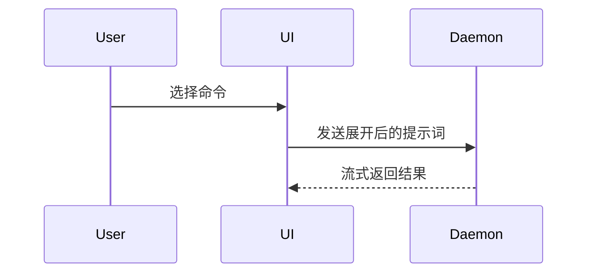

默认用简体中文提问、解释和交付；用户指定其他语言时遵从用户。代码、命令、路径、工具名、技术标识及约定的模板字段遵循目标项目约定。

使用以下模板编写 PR 正文：

```markdown
## Summary

<diagram, diff-sketch, or tree>

## Evidence

- **Before:** <screenshot/output/failing test run>
  **After:** <screenshot/output/passing test run>

## Merge Danger

**Door:** <one-way or two-way>

<optional: description>

**Blast Radius:** <one-word description>

<optional: potential ramifications of merge>
```

## 章节

省略所有开场白，文字保持简短。使用 `GLOSSARY.md` 中用户的领域语言。

### Summary

选择能把关键点讲清楚的最小视图。

- 用伪代码展示逻辑或算法：

```text
on(save)
  if content is unchanged
    return cached result
  write new content
  return fresh result
```

- 用调用树展示运行时控制流：

```text
submitForm
  createSession
    persistPrompt
    launchAgent
  navigateToSession
```

- 用组件树展示 UI 结构，包含重要的状态和模块边界：

```text
<SessionPage> (apps/example/src/routes/session.tsx)
  useSessionEvents()
  <SessionToolbar>
    <RunSkillButton> (packages/ui)
```

- 用浅层文件树展示文件职责或大范围重构：

```text
src/
├── commands/       # 解析用户操作
├── sessions/       # 管理会话状态
└── transport/      # 发送 API 请求
```

- 用 Mermaid 展示组件交互、控制流或数据流：



- 当重点在于变更内容，而周围结构已经存在时，使用 `diff`。让差异的展示结构与主题匹配。

组件变更：

```diff
 <SessionPage>
   useSessionEvents()
   <SessionToolbar>
+    <RunSkillButton />
   <SessionTimeline>
+    <SkillResultCard />
```

文件布局变更：

```diff
 src/
 ├── commands/
+│   └── show-me.ts       # 展开斜杠命令
 ├── sessions/
-└── transport.ts
+└── transport/
+    ├── client.ts
+    └── stream.ts
```

调用树或调用栈变更：

```diff
 submitForm
   createSession
     persistPrompt
+    expandSkillMention
     launchAgent
-  navigateToSession
+  navigateToSession
+    subscribeToEvents
```

状态或控制流变更：

```diff
 on(save)
-  write content
+  if content is unchanged
+    return cached result
+  write new content
+  invalidate cache
```

- 当大部分内容都是新增的、省略上下文会隐藏归属或顺序，或用户需要可复制的目标结构时，展示整个代码块：

```ts
function expandSkill(command: string): string {
  const skillName = command.slice(1);
  return `use the ${skillName} skill`;
}
```

#### 使用指引

将每个可视化视图放在它所支持的简短文字旁边。只保留回答用户当前问题，或说明当前讨论点的解决选项所需的调用、文件、props、状态和边界。

可以使用其中一种，也可以使用几种，通常不需要全部使用。自行判断，不要让用户负担过重。

### Evidence

提供证明变更有效的具体证据，展示前后对比。

当环境具备截图能力，且变更是视觉变化时，截图属于 S 级证据。

基于执行的证据属于 A 级，例如测试结果、控制台输出。用伪代码展示同一个测试在变更前失败、变更后通过的情况。

### Merge Danger

说明变更是单向门（one-way door）还是双向门（two-way door）。双向门可以走回去，单向门则不行。回滚成本低的 PR 风险较低。涉及破坏性操作或难以逆转的决策的变更属于单向门。

影响范围（blast radius）是本 PR 引入的变更可能造成的影响或波及范围。考虑所有可能性，例如布局偏移、使用方功能损坏、移动端响应式布局等。
